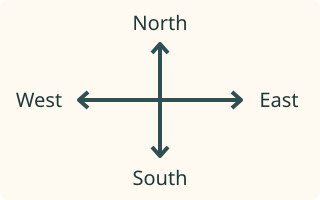

# Numbers 35 — Cities where people could find safety

**About this chapter**

Israel sets aside homes for the Levites and safe places for people waiting for a hearing.

## Homes for the Levites

## Numbers 35:1

The LORD spoke to Moses on the plains of Moab.

They were beside the Jordan River, across from Jericho.

## Numbers 35:2

Israel would soon receive land.

The LORD told Israel to give the Levites cities to live in.

They must also give the Levites pasture around each city.

## Numbers 35:3

The Levites would live in the cities.

Their herds, flocks, and other animals could graze outside.

**Reading help**

Pasture is land where animals eat grass.

## Numbers 35:4

The pasture would reach 1,000 cubits from each city wall.

This measure applied on every side.

**Reading help**

A cubit was a length measured from elbow to fingertip.

## Numbers 35:5

Israel must also measure 2,000 cubits outside the city on each side.

They must measure east, south, west, and north.

The city would stand in the middle of this larger pasture.

Point to each direction Israel had to measure.

## Six cities of refuge

## Numbers 35:6

Six of the Levites’ cities would be cities of refuge.

Someone who had killed another person could run there.

Israel must also give the Levites 42 other cities.

**Reading help**

Refuge means a safe place.

## Numbers 35:7

Altogether, the Levites would receive 48 cities with pasture.

## Numbers 35:8

Each tribe must give cities from its own land.

Tribes with more land must give more cities.

Tribes with less land could give fewer cities.

**Pause and answer**

Which tribes had to give more cities?

## A safe place until the hearing

## Numbers 35:9

The LORD spoke to Moses again.

## Numbers 35:10

Moses must tell Israel what to do when they crossed the Jordan into Canaan.

## Numbers 35:11

Israel must choose cities of refuge.

Anyone who killed someone by accident could run there.

## Numbers 35:12

The city would protect that person from the avenger.

The community must first hear the case.

Until then, the avenger could not put the person to death.

**Reading help**

The avenger was a relative of the person who died.

## Numbers 35:13

Israel must choose six cities of refuge.

## Numbers 35:14

Three cities would stand east of the Jordan.

Three more would stand in Canaan.

## Numbers 35:15

Israelites could use these six cities.

People from other lands who lived among them could use them too.

Anyone who killed someone by accident could go there.

**Pause and answer**

Who else could use these cities besides Israelites?

## When someone committed murder

## Numbers 35:16

The law called it murder if someone struck and killed another person with an iron object.

The penalty for murder was death.

## Numbers 35:17

The same law covered a fatal blow with a stone large enough to kill.

The court’s penalty for murder was death.

## Numbers 35:18

The same law covered a fatal blow with a wooden object that could kill.

The penalty for murder was death.

## Numbers 35:19

The avenger was responsible for putting the murderer to death when they met.

## Numbers 35:20

The law also covered a death caused by a hateful push.

It covered a death caused by throwing something at someone on purpose.

## Numbers 35:21

Someone might strike another person by hand out of hatred.

If that person died, the blow counted as murder.

The law required the avenger to put the murderer to death.

## When someone caused a death by accident

## Numbers 35:22

A sudden push could happen without hatred.

Someone could also throw something and hit another person by accident.

## Numbers 35:23

Someone might drop a heavy stone without seeing the person below.

The person who died was no enemy.

The one who dropped it meant no harm.

## Numbers 35:24

The community must hear both sides.

They must use these rules to judge between the person who caused the death and the avenger.

## Numbers 35:25

If the death was accidental, the community must protect the person from the avenger.

They must send that person back to the city of refuge.

The person must stay until the high priest died.

The high priest had received holy oil when he began his work.

**Pause and answer**

Who protected the person after an accidental death?

## Staying inside the city

## Numbers 35:26

The person might leave the city of refuge too soon.

## Numbers 35:27

The avenger might find and kill the person outside the city.

Under this law, the avenger would bear no guilt for that death.

## Numbers 35:28

The person who caused the death had to stay in the city until the high priest died.

After that, the person could go home to their own land.

## Numbers 35:29

Israel must keep this law wherever the people lived.

Their children and later generations must keep it too.

## Witnesses and payments

## Numbers 35:30

Before anyone could receive the death penalty for murder, witnesses had to speak.

One witness alone was never enough.

**Reading help**

A witness tells the community what happened.

## Numbers 35:31

Israel could accept no payment to spare a murderer’s life.

The death penalty still applied.

## Numbers 35:32

Israel could accept no payment for an early return home either.

The person in the city of refuge must wait until the high priest died.

**Pause and answer**

When could the person return home?

## The LORD lives among his people

## Numbers 35:33

The LORD told Israel that murder made the land unclean.

Only the death of the murderer could take away that guilt from the land.

## Numbers 35:34

Israel must keep the land where they lived clean before the LORD.

The LORD himself lived there among his people.
