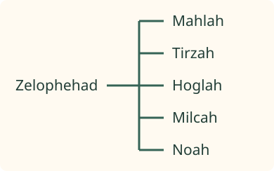

# Numbers 36 — The daughters of Zelophehad keep their family land

**About this chapter**

Five sisters inherit land. Their relatives ask Moses what will happen when the sisters marry.

## The family leaders bring a question

## Numbers 36:1

Leaders from Gilead’s family came to Moses and Israel’s family leaders.

Gilead was Machir’s son.

Machir was Manasseh’s son.

Their family belonged to the tribe of Joseph.

## Numbers 36:2

The leaders reminded Moses about two commands from the LORD.

Moses must divide Israel’s land by drawing lots.

Moses must give their relative Zelophehad’s land to his daughters.

**Reading help**

Drawing lots means using marked objects to decide who receives each share.

## Numbers 36:3

What if the daughters married men from another tribe?

Then their land would go to their husbands’ tribe.

Their father’s tribe would lose that land.

## Numbers 36:4

Even in the Jubilee year, their husbands’ tribe would keep the land.

It would no longer belong to their father’s tribe.

**Reading help**

The Jubilee was a special year when families could get their land back.

**Pause and answer**

What did the leaders fear their tribe would lose?

## Moses answers the leaders

## Numbers 36:5

The LORD gave Moses an answer for Israel.

Moses said the people from Joseph’s tribe were right.

## Numbers 36:6

The LORD said Zelophehad’s daughters could choose whom to marry.

Each must choose a man from a family in her father’s tribe.

**Pause and answer**

From which tribe could the daughters choose husbands?

## Numbers 36:7

Land must stay with the tribe that received it.

Each Israelite must keep the land passed down in the tribe.

## Numbers 36:8

This rule applied to every daughter who inherited land in Israel.

She must marry within a family of her father’s tribe.

That way each Israelite could keep the family land.

## Numbers 36:9

Land must never pass from one tribe to another.

Each tribe must keep its own land.

## The five sisters choose husbands

## Numbers 36:10

Zelophehad’s daughters did what the LORD had told Moses.

## Numbers 36:11

Their names were Mahlah, Tirzah, Hoglah, Milcah, and Noah.

All five women married cousins on their father’s side.

Each line connects Zelophehad to one daughter.

## Numbers 36:12

Their husbands came from families of Manasseh, Joseph’s son.

So the land stayed in their father’s tribe.

**Pause and answer**

What happened to the land after the sisters married?

## Numbers 36:13

These were the rules the LORD gave Israel through Moses.

The people were on the plains of Moab.

They were beside the Jordan River, across from Jericho.
