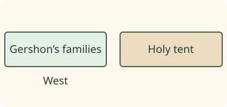

# Numbers 3 — The Levites care for the holy tent

**About this chapter**

Three families from the tribe of Levi care for the holy tent. Each has a place to camp and work to do. Moses also counts Israel’s firstborn.

## Aaron and his sons

## Numbers 3:1

This account tells about Aaron and Moses.

It comes from the time when the LORD spoke to Moses on Mount Sinai.

## Numbers 3:2

Aaron’s oldest son was Nadab.

His other sons were Abihu, Eleazar and Ithamar.

## Numbers 3:3

All four sons became priests.

They received oil as a sign that God had set them apart to serve.

## Numbers 3:4

In the Sinai wilderness, Nadab and Abihu offered fire the LORD had not commanded.

They died there before the LORD.

Neither had sons.

Only Eleazar and Ithamar served as priests during their father Aaron’s lifetime.

**Pause and answer**

Which two sons continued serving with Aaron?

## Work for the Levites

## Numbers 3:5

The LORD spoke to Moses.

## Numbers 3:6

He told Moses to bring the tribe of Levi to Aaron.

The Levites would help Aaron the priest.

## Numbers 3:7

They would serve Aaron and all the people of Israel.

Their work was at the Tent of Meeting, the holy tent.

## Numbers 3:8

They would look after everything used in the tent.

They would do this work on behalf of Israel.

## Numbers 3:9

Moses was to assign the Levites to Aaron and his sons.

From all Israel, the Levites were given entirely to Aaron for this work.

## Numbers 3:10

Aaron and his sons were to do the priests’ work.

Under this law, an outsider who approached the holy tent faced death.

**Pause and answer**

Whom did the Levites help?

## The Levites belong to the LORD

## Numbers 3:11

The LORD spoke to Moses again.

## Numbers 3:12

He had chosen the Levites from among the Israelites.

They would take the place of Israel’s firstborn children.

The Levites belonged to him.

**Reading help**

The firstborn is the first child born to a mother.

## Numbers 3:13

All the firstborn belonged to the LORD.

On the day he struck down Egypt’s firstborn, he set apart Israel’s firstborn for himself.

This included both people and animals.

He is the LORD.

**Pause and answer**

Whose place did the Levites take?

## Levi’s three sons

## Numbers 3:14

The LORD spoke to Moses in the Sinai wilderness.

## Numbers 3:15

He told Moses to count the Levites by family and clan.

Moses must count every boy and man at least one month old.

## Numbers 3:16

Moses counted them as the LORD had commanded.

## Numbers 3:17

Levi had three sons.

Their names were Gershon, Kohath and Merari.

## Numbers 3:18

Gershon’s sons were Libni and Shimei.

Their families formed clans.

## Numbers 3:19

Kohath’s sons were Amram, Izhar, Hebron and Uzziel.

Their families formed clans.

## Numbers 3:20

Merari’s sons were Mahli and Mushi.

These families made up Merari’s clans.

All the families listed above belonged to the tribe of Levi.

**Pause and answer**

What were the names of Levi’s three sons?

## Gershon’s families care for the curtains

## Numbers 3:21

The families of Libni and Shimei made up the two clans of Gershon.

## Numbers 3:22

These clans had 7,500 boys and men at least one month old.

## Numbers 3:23

Gershon’s clans camped behind the holy tent.

This was the west side.

Find the tent on the right. Gershon’s families camped behind it, on the west side.

## Numbers 3:24

Eliasaph son of Lael led Gershon’s families.

## Numbers 3:25

At the Tent of Meeting, they cared for the tent cloths and their covering.

They also cared for the curtain at the entrance.

## Numbers 3:26

A courtyard surrounded the holy tent and the altar.

Gershon’s clans looked after its curtains, its entrance curtain and the ropes.

All the work for these things belonged to them.

**Pause and answer**

Who cared for the courtyard curtains?

## Kohath’s families care for the holy things

## Numbers 3:27

Kohath’s clans came from Amram, Izhar, Hebron and Uzziel.

## Numbers 3:28

These clans had 8,600 boys and men at least one month old.

Kohath’s families cared for the holy place.

## Numbers 3:29

They camped south of the holy tent.

## Numbers 3:30

Elizaphan son of Uzziel led Kohath’s families.

## Numbers 3:31

They cared for the sacred chest called the ark.

They also cared for the table, lampstand and altars.

They looked after the tools for worship and the curtain.

All the work for these things belonged to them.

## Numbers 3:32

Eleazar, son of Aaron the priest, led the Levite leaders.

He directed those who cared for the holy place.

**Pause and answer**

Who led the Levite leaders?

## Merari’s families care for the tent supports

## Numbers 3:33

Merari’s clans came from Mahli and Mushi.

## Numbers 3:34

These clans had 6,200 boys and men at least one month old.

## Numbers 3:35

Zuriel son of Abihail led Merari’s families.

They camped north of the holy tent.

## Numbers 3:36

They cared for the frames that held up the tent.

They looked after the crossbars, posts, bases and other equipment.

All the work for these things belonged to them.

## Numbers 3:37

They also cared for the posts around the courtyard.

They looked after the bases, tent pegs and ropes.

**Pause and answer**

What held up the tent?

## The east side and the count

## Numbers 3:38

Moses, Aaron and Aaron’s sons camped in front of the tent.

This was the east side, where the sun rises.

They cared for the holy place on Israel’s behalf.

Under this law, an outsider who approached it faced death.

**Picture the holy tent**

| West of the tent | North of the tent | East of the tent |
| --- | --- | --- |
|  | Merari’s families |  |
| Gershon’s families | **Holy tent** | Moses, Aaron and Aaron’s sons |
|  | **South** • Kohath’s families |  |

## Numbers 3:39

The LORD had told Moses and Aaron to count the Levites by clan.

They counted boys and men at least one month old.

The total given was 22,000.

**Pause and answer**

Who camped on the east side?

## Moses counts Israel’s firstborn

## Numbers 3:40

Then the LORD told Moses to list Israel’s firstborn males by name.

Moses must count each one at least one month old.

## Numbers 3:41

The LORD would take the Levites in place of Israel’s firstborn.

He would take the Levites’ livestock in place of the other Israelites’ firstborn animals.

## Numbers 3:42

Moses counted Israel’s firstborn as the LORD had commanded.

## Numbers 3:43

The list held 22,273 names.

All were firstborn males at least one month old.

## Numbers 3:44

The LORD spoke to Moses again.

## Numbers 3:45

Moses must give the LORD the Levites in place of Israel’s firstborn.

He must also give the Levites’ livestock in place of the firstborn animals.

The Levites belonged to the LORD.

**Pause and answer**

How old did a firstborn boy have to be for this count?

## A payment for the remaining firstborn

## Numbers 3:46

There were 273 more firstborn Israelites than Levites.

Moses must collect a payment for those 273.

## Numbers 3:47

The payment was five shekels for each person.

Moses must use the weight called the sanctuary shekel.

Twenty smaller weights called gerahs made one shekel.

## Numbers 3:48

Moses must give this money to Aaron and his sons.

It was the price paid to release those remaining firstborn Israelites.

## Numbers 3:49

Moses collected the payment for those who remained after the Levites took the place of the others.

## Numbers 3:50

Moses collected 1,365 shekels from Israel’s firstborn.

He used the sanctuary shekel.

## Numbers 3:51

Moses gave this money to Aaron and his sons.

He did exactly what the LORD had commanded.

**Pause and answer**

Who received the payment from Moses?
