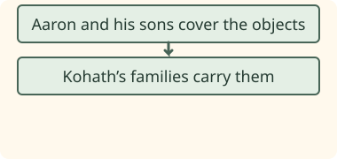

# Numbers 4 — Carrying the holy tent

**About this chapter**

When Israel moves, the priests pack the holy things. Three Levite families share the work of carrying the tent and everything used there.

## Who could do this work?

## Numbers 4:1

The LORD spoke to Moses and Aaron.

## Numbers 4:2

He told them to count the Levites from Kohath’s family.

They must count them by clan and family.

## Numbers 4:3

They must count the men aged thirty to fifty who could work at the Tent of Meeting.

## Numbers 4:4

Kohath’s families would care for the most holy things at the tent.

**Pause and answer**

How old were the men Moses and Aaron had to count?

## The priests cover the ark and table

## Numbers 4:5

When the camp was ready to move, Aaron and his sons went inside.

They took down the curtain.

They wrapped it around the ark, the chest holding God’s law.

## Numbers 4:6

They covered the ark with fine leather.

Over the leather they spread a plain blue cloth.

Then they put the carrying poles in place.

## Numbers 4:7

They spread a blue cloth over the table before the LORD.

On it they put the plates and cups.

They added the bowls and pitchers for the drink offering.

The bread regularly offered to God stayed on the table.

## Numbers 4:8

They spread a bright red cloth over these things.

They covered them with fine leather.

Then they put the carrying poles in place.

**Pause and answer**

What stayed on the table?

## The lampstand and the altars

## Numbers 4:9

They wrapped the lampstand and its lamps in blue cloth.

They included the tools for trimming the lamp wicks.

They also covered the trays and the oil jars.

**Reading help**

A wick is the part of an oil lamp that burns.

## Numbers 4:10

They wrapped the whole bundle in fine leather.

Then they set it on a carrying frame.

## Numbers 4:11

They spread a blue cloth over the gold altar.

They covered it with fine leather.

Then they put the carrying poles in place.

## Numbers 4:12

They gathered the other tools used in the holy place.

They wrapped them in blue cloth and fine leather.

Then they put them on a carrying frame.

## Numbers 4:13

They cleared the ashes from the bronze altar.

Then they spread a purple cloth over it.

## Numbers 4:14

They set the altar tools on top.

These included firepans, meat forks, shovels and sprinkling bowls.

They covered everything with fine leather.

Then they put the carrying poles in place.

**Pause and answer**

Which altar had a purple cloth?

## Kohath’s families carry the covered things

## Numbers 4:15

Aaron and his sons first covered all the holy things and their tools.

When the camp was ready, Kohath’s families came to carry them.

If the carriers touched the holy things themselves, they would die.

Carrying the covered things was their work at the tent.

The covering was in place before the carriers came.

## Numbers 4:16

Eleazar was the son of Aaron the priest.

He looked after the lamp oil and sweet-smelling incense.

He also looked after the daily grain offering and the special anointing oil.

He oversaw the whole tent, its holy things and their tools.

## Numbers 4:17

The LORD spoke to Moses and Aaron again.

## Numbers 4:18

They must keep Kohath’s families from dying out among the Levites.

## Numbers 4:19

Aaron and his sons must go inside first.

They must give each man his work.

They must tell him what to carry.

Then the men could come near the most holy things and live.

## Numbers 4:20

The men of Kohath must not enter to look at the holy things.

Even a brief look would cost them their lives.

**Pause and answer**

Who told each man what to carry?

## Gershon’s families carry curtains

## Numbers 4:21

The LORD spoke to Moses.

## Numbers 4:22

Moses must also count the people of Gershon by family and clan.

## Numbers 4:23

He must count the men aged thirty to fifty who came to work at the Tent of Meeting.

## Numbers 4:24

The LORD named the work for Gershon’s families.

He told them what to carry.

## Numbers 4:25

They carried the curtains of the holy tent.

They carried the tent and its fine leather cover.

They also carried the curtains at the tent entrance.

## Numbers 4:26

They carried the curtains around the courtyard and at its gate.

This courtyard surrounded the tent and the altar.

They carried the ropes and all the other equipment for this work.

They did whatever these items needed.

## Numbers 4:27

Aaron and his sons directed all this work.

They told Gershon’s families exactly what to carry.

## Numbers 4:28

Ithamar, son of Aaron the priest, directed Gershon’s families in their work at the Tent of Meeting.

**Pause and answer**

Who directed Gershon’s families at the tent?

## Merari’s families carry the frames

## Numbers 4:29

Moses must count Merari’s men by clan and family.

## Numbers 4:30

He must count the men aged thirty to fifty who came to work at the Tent of Meeting.

## Numbers 4:31

Merari’s men carried the frames of the holy tent.

They carried its crossbars, posts and bases.

## Numbers 4:32

They also carried the courtyard posts and their bases.

They took the tent pegs, ropes and other equipment used with them.

Each man must know the particular items he had to carry.

## Numbers 4:33

This was the work of Merari’s families at the Tent of Meeting.

Ithamar, son of Aaron the priest, directed them.

**Who carries what?**

| Family | Examples of things they carry |
| --- | --- |
| Kohath | The covered ark, table and lampstand |
| Gershon | The tent cloths and courtyard curtains |
| Merari | The frames, posts and bases |

**Pause and answer**

What parts of the tent did Merari’s men carry?

## Counting workers from Kohath and Gershon

## Numbers 4:34

Moses, Aaron and the leaders counted Kohath’s men by clan and family.

## Numbers 4:35

They counted men aged thirty to fifty who came to work at the Tent of Meeting.

## Numbers 4:36

They counted 2,750 men in Kohath’s clans.

## Numbers 4:37

These men could serve at the Tent of Meeting.

Moses and Aaron counted them as the LORD had told Moses.

## Numbers 4:38

The leaders counted Gershon’s men by clan and family.

## Numbers 4:39

They counted men aged thirty to fifty who came to work at the Tent of Meeting.

## Numbers 4:40

They counted 2,630 men in Gershon’s clans and families.

## Numbers 4:41

These men served at the Tent of Meeting.

Moses and Aaron counted them as the LORD commanded.

**Pause and answer**

How many workers came from Gershon’s clans?

## Counting Merari’s workers and the whole group

## Numbers 4:42

The leaders counted Merari’s men by clan and family.

## Numbers 4:43

They counted men aged thirty to fifty who came to work at the Tent of Meeting.

## Numbers 4:44

They counted 3,200 men in Merari’s clans.

## Numbers 4:45

Moses and Aaron counted these men from Merari’s clans.

They did what the LORD had told Moses.

## Numbers 4:46

Moses, Aaron and Israel’s leaders counted the Levites by clan and family.

## Numbers 4:47

They counted men aged thirty to fifty who came to serve.

These men worked at the Tent of Meeting and helped carry it.

## Numbers 4:48

Altogether they counted 8,580 men.

## Numbers 4:49

The leaders counted them as the LORD had told Moses.

Each man received a job and a load to carry.

This was what the LORD had commanded.

**Pause and answer**

What did each man receive after the count?
