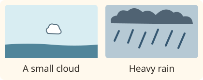

# Proverbs 16 — The LORD guides our steps

**About this chapter**

Solomon speaks about the plans we make and the words we choose. The LORD knows what moves us to act.

## The LORD knows our reasons

## Proverbs 16:1

We plan what we want to say.

The answer we give comes from the LORD.

## Proverbs 16:2

You may think everything you do is right.

The LORD examines why you do it.

## Proverbs 16:3

Trust the LORD with the work you do.

Then your plans will succeed.

## Proverbs 16:4

The LORD made everything for his purpose.

Even the wicked have a day of disaster ahead.

## Proverbs 16:5

The LORD hates a proud heart.

Be sure of this.

The proud will face punishment.

## Choosing what is right

## Proverbs 16:6

Faithful love and truth make amends for wrongdoing.

Deep respect for the LORD helps people turn from evil.

## Proverbs 16:7

When your ways please the LORD, he brings peace.

He can make even your enemies live peacefully with you.

## Proverbs 16:8

It is better to have little and do right than to gain much by treating people unfairly.

## Proverbs 16:9

You can plan where you want to go.

The LORD decides the steps you take.

## A king must judge fairly

## Proverbs 16:10

A king speaks for God when he gives a judgment.

The king must give a fair decision.

## Proverbs 16:11

The LORD gives us honest ways to weigh things.

He cares about every weight a seller puts on the scales.

## Proverbs 16:12

It is a terrible thing for kings to do evil.

Doing right makes a king’s rule strong.

## Proverbs 16:13

A king delights in hearing the truth.

He loves people who speak honestly.

## Proverbs 16:14

An angry king can send someone to their death.

A wise person knows how to calm him.

## Proverbs 16:15

When the king’s face lights up, it means life.

His kindness is like a cloud bringing spring rain.

**Look for the rain**

Find the falling rain. Imagine a farmer waiting for water for the new crops. That welcome rain helps explain the joy of seeing kindness on the king’s face.

## What wisdom is worth

## Proverbs 16:16

Gaining wisdom is better than gaining gold.

Understanding is worth more than silver.

## Proverbs 16:17

Honest people take a road away from evil.

Paying attention to your choices protects your life.

## Proverbs 16:18

Pride leads to ruin.

Thinking you are above others comes before a fall.

## Proverbs 16:19

It is better to live humbly among humble people than to share what proud people have seized.

## Proverbs 16:20

Those who follow good teaching do well.

Happy are those who trust the LORD.

## Words that help others learn

## Proverbs 16:21

People recognize good judgment in someone wise.

Kind words help others learn.

## Proverbs 16:22

Understanding gives life like a spring of fresh water.

Foolish people suffer from their own foolishness.

## Proverbs 16:23

Wise people think about what to say.

Their understanding helps others listen and learn.

## Proverbs 16:24

Kind words are like honey from a honeycomb.

They bring sweetness to your day and strength to your body.

## Choices that bring harm

## Proverbs 16:25

A road may seem right to the person taking it.

Yet it can lead to death.

## Proverbs 16:26

Hunger gives a worker a reason to keep going.

The worker needs food.

## Proverbs 16:27

A troublemaker digs up ways to do harm.

That person’s words hurt like a burning fire.

## Proverbs 16:28

Someone who twists the truth starts quarrels.

Gossip can separate even close friends.

## Proverbs 16:29

A violent person draws a neighbor into doing wrong.

That person leads the neighbor down a harmful path.

## Proverbs 16:30

A wink can be a secret signal to do wrong.

Someone planning harm may press their lips together.

## Honor and self-control

## Proverbs 16:31

Gray hair is like a beautiful crown.

It honors a long life spent doing right.

## Proverbs 16:32

Someone who is slow to anger is better than a great fighter.

Controlling your temper matters more than capturing a whole city.

## Proverbs 16:33

People tossed small objects called lots into their laps to make a choice.

Each decision came from the LORD.

**Pause and answer**

Who guides your steps when you make plans?
