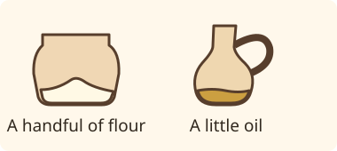

# Proverbs 21 — Hear the cry of the poor

**About this chapter**

Solomon asks us to listen when someone needs help. He looks at what we save for ourselves and what we give away.

## The LORD sees the heart

## Proverbs 21:1

A farmer can turn a stream toward a field.

In the same way, the LORD can turn a king’s heart wherever he chooses.

## Proverbs 21:2

What you do may seem right to you.

The LORD knows why you do it.

## Proverbs 21:3

The LORD values right actions and fair treatment more than offerings at his altar.

## Proverbs 21:4

Wicked people look down on others.

They let pride guide them.

That pride is sin.

## What becomes of dishonest gain

## Proverbs 21:5

People who plan and work steadily have plenty.

Rushing ahead leads to poverty.

## Proverbs 21:6

Money you gain by lying disappears like mist.

Chasing it can cost you your life.

## Proverbs 21:7

Wicked people refuse to treat others fairly.

Their own violence sweeps them away.

## Proverbs 21:8

Guilty people follow a crooked path.

Innocent people act honestly.

## Choices at home

## Proverbs 21:9

A corner of the roof is a better place to live than a house shared with a wife who keeps picking fights.

## Proverbs 21:10

A wicked person longs to do harm.

Even a neighbor can expect no kindness.

## Proverbs 21:11

When someone who mocks others faces punishment, onlookers learn caution.

A wise person learns from instruction.

## Proverbs 21:12

The Righteous One is God, who always does right.

He watches the home of the wicked.

He brings wicked people to ruin.

## When someone calls for help

## Proverbs 21:13

Someone who is poor cries out for help.

If you refuse to listen, one day you too will cry out.

No one will answer.

## Proverbs 21:14

A gift given in secret can calm anger.

Even someone who is furious may calm down after a secret bribe.

## Proverbs 21:15

When a judge acts fairly, good people rejoice.

People who do wrong have reason to fear.

## Proverbs 21:16

Someone who leaves the path of good judgment will end up among the dead.

## What people spend and save

## Proverbs 21:17

Living for pleasure leads to poverty.

Someone who lives for wine and costly oil will never grow rich.

## Proverbs 21:18

Wicked people pay the price in place of good people.

People who break trust take the place of the honest.

## Proverbs 21:19

Life in the desert is better than life with a wife who is always angry and arguing.

## Proverbs 21:20

Wise people keep valuable things and oil in their homes.

A foolish person uses everything up.

**Find the oil jug**

Look for the narrow jug with a handle. Imagine saving some oil for tomorrow’s meal. That is one way a household can care for what it has.

## Love, wisdom, and careful words

## Proverbs 21:21

Keep doing right and showing faithful love.

You will find life, goodness, and honor.

## Proverbs 21:22

A wise person can climb the walls of a powerful city.

Even the fort its people trust can fall to wisdom.

## Proverbs 21:23

Choose your words with care.

That can save you much trouble.

## Proverbs 21:24

People call someone a mocker when pride rules his actions.

He acts as if he is above everyone.

## Wanting more or giving freely

## Proverbs 21:25

Someone may want things yet refuse to work for them.

That longing can cost him his life.

## Proverbs 21:26

All day he wants more for himself.

Someone who does right gives freely.

## Proverbs 21:27

The LORD hates the offering a wicked person brings.

How much worse when the giver plans to do harm!

## Proverbs 21:28

A lying witness will perish.

Someone who listens to the truth will have words that last.

## The LORD decides the outcome

## Proverbs 21:29

A wicked person puts on a bold face.

An honest person takes care to follow the right path.

## Proverbs 21:30

No one can outthink the LORD.

No advice or plan can defeat him.

## Proverbs 21:31

People get a horse ready for battle.

The victory comes from the LORD.

**Pause and answer**

In verse 13, who is calling for help?
