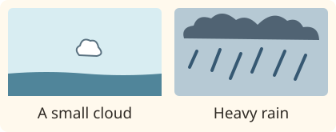

# Psalm 147 — God gathers his people home

**About this psalm**

The singer praises the LORD who knows the stars by name. That same God cares for people in sorrow and for young birds calling for food.

## God knows the brokenhearted and the stars

## Psalm 147:1

Hallelujah! Praise the LORD!

How good and lovely it is to sing to our God!

## Psalm 147:2

The LORD rebuilds Jerusalem.

He gathers the people of Israel who had to leave home.

## Psalm 147:3

He heals those whose hearts are broken.

He wraps their wounds.

## Psalm 147:4

He counts the stars.

He calls each one by name.

## Psalm 147:5

Our Lord is great and powerful.

There is no limit to what he understands.

## Psalm 147:6

The LORD holds humble people up.

He throws those who do evil to the ground.

## Rain for the grass and food for the birds

## Psalm 147:7

Give thanks to the LORD in song.

Play the harp for our God.

## Psalm 147:8

He covers the sky with clouds.

He sends rain to the earth and makes grass grow on the hills.

**Look at the cloud**

Imagine the rain falling on a hillside. The singer sees God caring for the animals by making grass grow there.

## Psalm 147:9

He feeds the animals.

He feeds the young ravens when they call.

## Psalm 147:10

A horse’s strength is not what delights him.

A runner’s strong legs are not what pleases him.

## Psalm 147:11

The LORD delights in people who honor him and hope in his lasting love.

## Peace for Jerusalem

## Psalm 147:12

Jerusalem, tell how great the LORD is!

People of Zion, praise your God!

## Psalm 147:13

He makes the bars on your gates strong.

He blesses the children inside your city.

## Psalm 147:14

He brings peace to your borders.

He gives you plenty of the finest wheat.

## Snow, frost, and flowing water

## Psalm 147:15

He sends his command across the earth.

His word travels quickly.

## Psalm 147:16

He spreads snow like a blanket of wool.

He scatters frost like fine ashes.

## Psalm 147:17

He throws down hailstones like pebbles.

Who can stand against his freezing wind?

## Psalm 147:18

He gives the word, and the ice melts.

He sends the wind, and water flows again.

## Psalm 147:19

He speaks his word to Jacob’s family.

He gives Israel his rules and decisions.

## Psalm 147:20

He has done this for no other nation.

The other nations do not know his decisions.

Praise the LORD!

**Pause and answer**

What does God do when the young ravens call?
