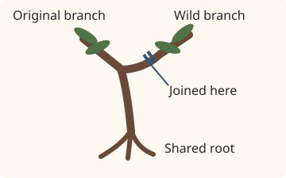

# Psalm 52 — David trusts in God’s faithful love

**About this psalm**

David speaks to a man who uses words to hurt people. Then David speaks to God and tells him why he will keep trusting him.

## Words that hurt

## Psalm 52:1

David wrote this song, called a Maskil, for the music leader.

Doeg, a man from Edom, had gone to Saul.

Doeg told him, “David went to Ahimelech’s house.”

You powerful man, why brag about doing evil?

God’s faithful love lasts all day long.

## Psalm 52:2

You plan to ruin people with your lies.

Your tongue cuts like a sharp razor.

## Psalm 52:3

You love doing wrong more than doing good.

You would rather lie than tell the truth.

Selah.

**Words in the song**

Maskil is an old word for a kind of song. Selah appears twice in this song. The exact meaning of these terms is uncertain.

## Psalm 52:4

You love to tell lies.

You love every word that tears someone down.

## What happens to the man who trusts his wealth

## Psalm 52:5

God will bring you down for good.

He will pull you out of your tent.

Like a tree pulled up by its roots, you will lose your place among the living.

Selah.

## Psalm 52:6

People who do right will see this and stand in awe.

They will laugh at the man who did evil and say,

## Psalm 52:7

“Look at him! He never turned to God for safety.

He trusted his great wealth.

He made himself powerful by ruining others.”

**Pause and answer**

What did the powerful man trust to keep him safe?

## An olive tree in God’s house

## Psalm 52:8

As for me, I am like an olive tree growing strong in God’s house.

I will trust in God’s faithful love forever.

**Look at the olive tree**

Find the roots, then follow the trunk up to the leaves. David pictures himself growing strong like this tree because he trusts God’s faithful love.

## Psalm 52:9

God, I will always praise you for what you have done.

Among your faithful people, I will wait for you with hope.

Your name is good.

**Pause and answer**

In your own words, why does David compare himself to a growing tree?
