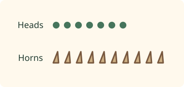

# Revelation 13 — A beast from the sea and a beast from the land

**About this chapter**

John sees two beasts in his vision.

Notice where each beast comes from and what each one does.

## The beast from the sea

## Revelation 13:1

I saw a beast rising out of the sea.

It had ten horns and seven heads.

Ten royal crowns rested on its horns.

The names on its heads insulted God.

Count each row separately to follow John’s description.

## Revelation 13:2

The beast looked like a leopard.

Its feet were like a bear’s feet.

Its mouth was like a lion’s mouth.

The dragon gave the beast his power and his throne.

He gave it great authority to rule.

## Revelation 13:3

One head looked as though it had received a deadly wound.

Yet the wound healed.

People throughout the world were amazed and followed the beast.

## Revelation 13:4

They worshiped the dragon for giving the beast authority.

They also worshiped the beast.

They asked, “Who is like the beast?

Who can fight it?”

**Pause and answer**

Who gave the first beast its authority?

## The first beast speaks against God

## Revelation 13:5

The beast received the power to boast and insult God.

It had authority to act for forty-two months.

## Revelation 13:6

The beast spoke against God.

It insulted God’s name and his dwelling.

It spoke against those who live in heaven.

## Revelation 13:7

The beast received permission to fight and defeat God’s holy people.

It received authority over every tribe, people, language and nation.

## Revelation 13:8

People on earth will worship the beast unless their names are in the Book of Life.

This book belongs to the Lamb who was killed.

The names in it have been there since the world began.

**Pause and answer**

To whom does the Book of Life belong?

## A call to keep trusting God

## Revelation 13:9

Anyone who can hear, listen closely.

## Revelation 13:10

Those meant for prison will go to prison.

Those meant to die by the sword will die by the sword.

God’s people must keep going and keep trusting him.

**Pause and answer**

What does John ask God’s people to keep doing?

## A second beast comes from the land

## Revelation 13:11

Then I saw another beast rise from the land.

It had two horns like a lamb’s horns.

Its voice sounded like a dragon’s voice.

## Revelation 13:12

This second beast used all the authority of the first beast.

It made the earth and its people worship the first beast.

That was the beast whose deadly wound had healed.

**Picture the two beasts**

| Where it came from | What John noticed |
| --- | --- |
| The sea | Seven heads and ten horns |
| The land | Two horns like a lamb’s horns |

## Revelation 13:13

The second beast performed great signs.

People watched it bring fire down from heaven to earth.

**Pause and answer**

Which beast does the second beast make people worship?

## An image of the first beast

## Revelation 13:14

The second beast had power to do these signs for the first beast.

The signs fooled people on earth.

It told them to make an image of the first beast.

That beast had survived a wound from a sword.

**Reading help**

An image is something made to look like someone or something else.

## Revelation 13:15

The second beast received power to give breath to the image.

The image could now speak.

It had everyone killed who refused to worship it.

**Pause and answer**

What could the image do once it received breath?

## The mark and the number

## Revelation 13:16

The second beast made everyone receive a mark.

This included the powerful and the lowly, the rich and the poor.

It included both free people and slaves.

The mark went on the right hand or the forehead.

## Revelation 13:17

People needed the mark to buy or sell anything.

The mark was the beast’s name or the number of its name.

## Revelation 13:18

This calls for wisdom.

Anyone with understanding should work out the beast’s number.

It is the number of a man.

Its number is 666.

**Pause and answer**

What could people only do if they had the mark?
