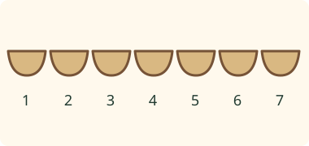

# Revelation 16 — The seven angels pour out their bowls

**About this chapter**

John hears a command from the temple.

As each angel pours out a bowl, John sees what happens.

## The first three bowls — Land, sea and rivers

## Revelation 16:1

I heard a loud voice from the temple.

It told the seven angels, “Go and pour out the seven bowls of God’s anger on the earth.”

Each angel has one bowl to pour out.

## Revelation 16:2

The first angel poured his bowl on the land.

Terrible, painful sores broke out on people’s skin.

These people bore the beast’s mark and worshiped its image.

## Revelation 16:3

The second angel poured his bowl into the sea.

The sea became like the blood of a dead person.

Every living thing in the sea died.

## Revelation 16:4

The third angel poured his bowl into rivers and springs.

Their water turned to blood.

**Reading help**

| Bowl | Where the angel poured it |
| --- | --- |
| First | Land |
| Second | Sea |
| Third | Rivers and springs |

**Pause and answer**

What happened to the rivers when the third angel poured out his bowl?

## The angel of the waters speaks

## Revelation 16:5

I heard the angel of the waters speak to God.

“Holy One, you are here now, and you were here before.

You have judged rightly.

## Revelation 16:6

“These people spilled the blood of your holy people and prophets.

Now you have given them blood to drink.

They have received what they deserve.”

## Revelation 16:7

I heard the altar answer.

“Yes, Lord God Almighty.

Your judgments are true and fair.”

**Pause and answer**

How does the angel describe God’s judgment?

## The fourth and fifth bowls — Heat and darkness

## Revelation 16:8

The fourth angel poured his bowl on the sun.

The sun received power to burn people with fire.

## Revelation 16:9

The fierce heat burned them.

They cursed God, who had power over these plagues.

They still refused to turn back and honor him.

## Revelation 16:10

The fifth angel poured his bowl on the beast’s throne.

Darkness covered the beast’s kingdom.

People bit their tongues because the pain was so great.

## Revelation 16:11

They cursed the God of heaven because of their pain and sores.

Still they refused to turn from what they had done.

**Pause and answer**

What did the people refuse to do?

## The sixth bowl — The kings gather

## Revelation 16:12

The sixth angel poured his bowl on the great river Euphrates.

Its water dried up.

This opened a way for kings coming from the east.

## Revelation 16:13

I saw three evil spirits that looked like frogs.

One came from the dragon’s mouth, one from the beast’s mouth, and one from the false prophet’s mouth.

## Revelation 16:14

These spirits are demons that perform signs.

They go to the kings of the whole world.

They gather them for battle on the great day of God Almighty.

## Revelation 16:15

“Look, I am coming like a thief.

Happy is the person who stays awake and keeps their clothes ready.

They will not have to go out naked in shame.”

**Reading help**

A thief comes unexpectedly. Staying dressed and awake is a picture of being ready.

## Revelation 16:16

The spirits gathered the kings in one place.

Its Hebrew name is Armageddon.

**Pause and answer**

Where did the spirits gather the kings?

## The seventh bowl — A voice from the throne

## Revelation 16:17

The seventh angel poured his bowl into the air.

A loud voice from the throne in the temple said, “It is done!”

## Revelation 16:18

Lightning flashed.

Thunder rumbled and crashed.

An earthquake shook the earth.

No earthquake so powerful had struck since people first lived on earth.

## Revelation 16:19

The great city split into three parts.

Cities across the nations fell.

God remembered Babylon the great.

He made Babylon drink from the cup of his fierce anger.

**Reading help**

The cup pictures Babylon receiving God’s judgment.

## Revelation 16:20

Every island disappeared.

No one could find a mountain anywhere.

## Revelation 16:21

Huge hailstones fell from the sky onto the people.

Each weighed nearly a hundred pounds, about forty-five kilograms.

The hail was so terrible that people cursed God because of it.

**Pause and answer**

What did the voice from the throne say?
