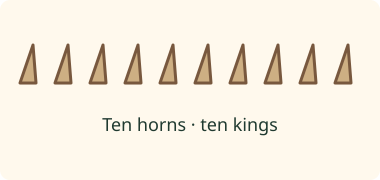

# Revelation 17 — The angel explains the woman and the beast

**About this chapter**

John is amazed by what he sees in the wilderness.

An angel explains the signs to him.

## John sees a woman in the wilderness

## Revelation 17:1

One of the seven angels who held the bowls came to me.

“Come,” the angel said.

“I will show you the punishment of the great prostitute.

She sits on many waters.”

**Reading help**

A prostitute is someone who sells sex. The angel will explain what this woman represents.

## Revelation 17:2

The angel said the kings of the earth had sex with her.

People everywhere had become drunk on the wine of her wrongdoing.

## Revelation 17:3

In the Spirit, the angel carried me into the wilderness.

I saw a woman riding a bright red beast.

Names that insulted God covered the beast.

It had seven heads and ten horns.

## Revelation 17:4

The woman wore purple and bright red clothes.

She wore gold, fine stones and pearls.

She held a gold cup.

It was full of hateful things and the filth of her sexual wrongdoing.

**Pause and answer**

What did the woman hold in her hand?

## The name on her forehead

## Revelation 17:5

A name with a hidden meaning appeared on her forehead.

It called her Babylon the Great.

It called her the mother of prostitutes and of the earth’s hateful deeds.

## Revelation 17:6

I saw that the woman was drunk with blood.

It was the blood of God’s holy people and of those who spoke for Jesus.

I stared at her in amazement.

## Revelation 17:7

The angel asked why I was so amazed.

The angel offered to explain the woman and the beast that carried her.

This was the beast with seven heads and ten horns.

**Pause and answer**

Who offered to explain the vision?

## The beast and its seven heads

## Revelation 17:8

The angel said the beast once lived, but now was gone.

It would come up from the deep pit called the Abyss.

Then it would go to its destruction.

Some people’s names have been missing from the Book of Life since the world began.

Those people will marvel when the beast appears again.

## Revelation 17:9

The angel said it takes wisdom to understand this.

The seven heads stand for seven mountains where the woman sits.

## Revelation 17:10

They also stand for seven kings.

Five have fallen.

One rules now.

The last has yet to come.

When he comes, he must stay only a short time.

## Revelation 17:11

The beast that once lived and now is gone is an eighth king.

He belongs among the other seven.

He is going to his destruction.

**Pause and answer**

How long will the seventh king stay?

## Ten kings give up their power

## Revelation 17:12

The ten horns stand for ten kings.

They have no kingdoms yet.

They will have power to rule with the beast for one hour.

Each mark represents one of the kings the angel describes.

## Revelation 17:13

These kings agree on one thing.

They will hand their power and authority to the beast.

## Revelation 17:14

They will fight the Lamb.

The Lamb will defeat them.

He is Lord over every lord and King over every king.

His faithful people will be with him.

He called them and chose them.

**Pause and answer**

Why will the Lamb defeat the kings?

## The waters and the woman

## Revelation 17:15

The angel explained the waters where the woman sat.

They stand for crowds from many peoples, nations and languages.

## Revelation 17:16

The ten horns and the beast will hate the woman.

They will take everything and leave her naked.

They will eat her flesh and burn her with fire.

## Revelation 17:17

God has moved these kings to carry out his purpose.

They agree to give the beast their power to rule.

This will last until God’s words come true.

## Revelation 17:18

The angel said the woman I saw stands for the great city.

That city rules over the kings of the earth.

**Reading help**

| What John saw | What the angel explained |
| --- | --- |
| Seven heads | Seven mountains and seven kings |
| Ten horns | Ten kings |
| Waters | Many peoples |
| Woman | The great city |

**Pause and answer**

What does the woman stand for?
