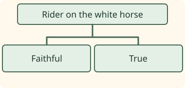

# Revelation 19 — Praise in heaven and the rider on the white horse

**About this chapter**

John hears a crowd praise God.

Later he sees heaven open and a rider appear.

## The crowd cries Hallelujah

## Revelation 19:1

Then I heard a roar like a great crowd in heaven.

They shouted, “Hallelujah!

Our God saves!

Glory and power belong to him!”

**Reading help**

Hallelujah means “Praise the Lord.”

## Revelation 19:2

They praised God because he judges truly and fairly.

He judged the great prostitute who led the earth into sexual wrongdoing.

He punished her for killing his servants.

## Revelation 19:3

Again they shouted, “Hallelujah!

The smoke from her fire rises forever.”

## Revelation 19:4

The twenty-four elders and four living creatures bowed down.

They worshiped God, who sits on the throne.

They said, “Amen!

Hallelujah!”

## Revelation 19:5

A voice from the throne called, “Praise our God, all his servants!

Everyone who honors him, great or small, praise him!”

**Pause and answer**

Whom do the elders worship?

## The Lamb’s wedding

## Revelation 19:6

Then I heard something like a great crowd shouting.

It sounded like rushing waters and loud thunder.

“Hallelujah!” they cried.

“The Lord our God, the Almighty, rules!”

## Revelation 19:7

They said, “Let us rejoice and give him glory!

The time has come for the Lamb’s wedding.

His bride is ready.”

## Revelation 19:8

The bride received fine linen clothes, bright and clean.

The linen stands for the good deeds of God’s holy people.

**Pause and answer**

What do the bride’s clean clothes stand for?

## The angel tells John whom to worship

## Revelation 19:9

The angel told me what to write.

“God blesses those invited to the Lamb’s wedding meal.” Then he told me these were God’s true words.

## Revelation 19:10

I bowed at the angel’s feet to worship him.

He told me to stop.

“Like you, I serve God.

So do your brothers and sisters who hold to the testimony of Jesus.

Worship God!

The testimony of Jesus is the spirit of prophecy.”

**Reading help**

Prophecy means speaking a message from God. Here the angel connects that message with what Jesus makes known.

**Pause and answer**

Whom does the angel tell John to worship?

## The rider is called Faithful and True

## Revelation 19:11

I saw heaven open, and there was a white horse.

Its rider is called Faithful and True.

He judges fairly and does what is right when he makes war.

The names help explain why the rider judges fairly.

## Revelation 19:12

His eyes are like flames.

He wears many royal crowns.

A name is written on him that only he knows.

## Revelation 19:13

He wears a robe dipped in blood.

His name is the Word of God.

## Revelation 19:14

The armies of heaven follow him on white horses.

They wear clean, white linen.

## Revelation 19:15

A sharp sword comes from the rider’s mouth.

With it he strikes down the nations.

He will rule them with an iron rod.

He treads the winepress of the fierce anger of God Almighty.

**Reading help**

A winepress is where people crush grapes. Here it pictures God carrying out judgment.

## Revelation 19:16

On his robe and on his thigh this name appears.

“King of kings and Lord of lords.”

**Pause and answer**

What name appears on the rider’s robe and thigh?

## The beast and its army are defeated

## Revelation 19:17

Then I saw an angel standing in the sun.

He called loudly to all the birds overhead.

“Come together for God’s great supper!

## Revelation 19:18

“You will eat the flesh of kings, commanders and strong men.

You will eat the flesh of horses and riders.

People of every rank will lie there, enslaved and free.”

**Reading help**

**Two meals in John’s vision**

| Meal | Who receives the invitation? |
| --- | --- |
| The Lamb’s wedding meal | The guests God blesses |
| The meal announced before the battle | The birds overhead |

## Revelation 19:19

I saw the beast and the kings of the earth gather their armies.

They came to fight the rider and his army.

## Revelation 19:20

The beast and the false prophet were captured.

The false prophet had done signs for the beast.

He had fooled those who took the beast’s mark and worshiped its image.

The beast and the false prophet were thrown alive into the lake of burning sulfur.

## Revelation 19:21

The sword from the rider’s mouth killed the rest of their army.

The birds ate their fill.

**Pause and answer**

Who gathered to fight the rider?
