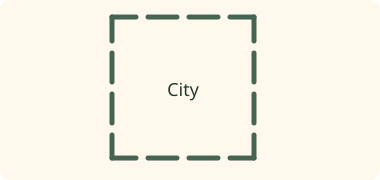

# Revelation 21 — God makes all things new

**About this chapter**

John sees the new Jerusalem come down from God.

An angel shows him the city and its open gates.

## God comes to live with his people

## Revelation 21:1

I saw a new heaven and a new earth.

The first heaven and earth had passed away.

The sea too was gone.

## Revelation 21:2

I saw the holy city, the new Jerusalem.

It came down from God out of heaven.

It was ready like a bride dressed for her wedding.

## Revelation 21:3

A loud voice came from the throne.

“Look!

God’s home is with his people.

He will live with them.

They will be his people.

God himself will be with them as their God.”

## Revelation 21:4

God will wipe every tear from their eyes.

No one will die, mourn, cry or hurt anymore.

The things that once brought pain have passed away.

**Pause and answer**

Who will wipe away the tears?

## Water for the thirsty

## Revelation 21:5

The one on the throne said, “Look!

I am making everything new.” He told me to write this down.

His words are true and can be trusted.

## Revelation 21:6

He told me, “It is done!

I am the Alpha and the Omega, the Beginning and the End.

I will give thirsty people water from the spring of life.

It will cost them nothing.

**Reading help**

Alpha and Omega are the first and last letters of the Greek alphabet.

## Revelation 21:7

“Whoever overcomes will receive all this as an inheritance.

I will be their God.

They will be my children.”

## Revelation 21:8

He also spoke of those who give in to fear, refuse to believe or do hateful things.

He named murderers, those who do wrong sexually, and those who practice sorcery.

He named those who worship idols and all who lie.

Their place will be in the lake burning with fire and sulfur.

This is the second death.

**Pause and answer**

What does God offer thirsty people?

## The angel shows John the bride

## Revelation 21:9

One of the seven angels who held bowls of the seven last plagues came to me.

“Come,” he said.

“I will show you the bride, the wife of the Lamb.”

## Revelation 21:10

In the Spirit, the angel carried me to a great high mountain.

He showed me the holy city, Jerusalem.

It was coming down from God out of heaven.

## Revelation 21:11

It shone with God’s glory.

Its light was like a precious jasper stone, clear as crystal.

**Pause and answer**

What does the angel show John from the mountain?

## Twelve gates and twelve foundations

## Revelation 21:12

A great high wall surrounded the city.

Twelve angels stood at its twelve gates.

On the gates were the names of Israel’s twelve tribes.

## Revelation 21:13

Three gates faced east, three north, three south and three west.

Follow the wall around the city. Count three gates on every side.

**Reading help**

| Side of the city | Gates |
| --- | --- |
| North | 3 |
| South | 3 |
| East | 3 |
| West | 3 |

## Revelation 21:14

The wall rested on twelve foundations.

On them were the names of the Lamb’s twelve apostles.

These were the messengers Jesus sent.

**Pause and answer**

Whose names are on the gates?

## The angel measures the city

## Revelation 21:15

The angel who spoke to me held a gold measuring rod.

He used it to measure the city, its gates and its wall.

## Revelation 21:16

The city was square.

With his rod the angel measured 12,000 stadia along each side.

Its height was the same as its length and width.

## Revelation 21:17

The angel measured the wall at 144 cubits.

He used the same measure people use.

**Reading help**

Stadia and cubits were measures of length. The city measured about 2,200 kilometers each way. The wall measured about 65 meters.

**Pause and answer**

How does the city’s height compare with its width?

## The stones and the pearls

## Revelation 21:18

The wall was jasper.

The city itself was pure gold, as pure as glass.

## Revelation 21:19

Precious stones of every kind adorned the foundations.

The first was jasper, the second sapphire, the third chalcedony and the fourth emerald.

## Revelation 21:20

The fifth was sardonyx, the sixth carnelian, the seventh chrysolite and the eighth beryl.

The ninth was topaz, the tenth chrysoprase, the eleventh jacinth and the twelfth amethyst.

## Revelation 21:21

Each of the twelve gates was a single pearl.

The city’s main street was pure gold, as clear as glass.

**Pause and answer**

What is each gate made of?

## God gives the city light

## Revelation 21:22

I saw no temple building in the city.

The Lord God Almighty and the Lamb are its temple.

## Revelation 21:23

The city needs neither sun nor moon for light.

God’s glory gives it light.

The Lamb is its lamp.

## Revelation 21:24

The nations will walk by its light.

Earth’s kings will bring their glory into the city.

## Revelation 21:25

The gates will never close at the end of the day.

There will be no night there.

## Revelation 21:26

People will bring the glory and honor of the nations into the city.

## Revelation 21:27

Nothing unclean will ever enter.

No one who practices hateful things or lies will enter.

Only those named in the Lamb’s Book of Life may come in.

**Pause and answer**

Why can the gates stay open?
