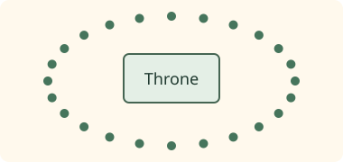

# Revelation 4 — John sees a throne in heaven

**About this chapter**

John tells what he saw and heard.

Listen for the words the four living creatures repeat.

## A door stands open

## Revelation 4:1

After this I saw an open door in heaven.

I heard the same voice I had heard before.

It sounded like a trumpet.

The voice said, “Come up here.

I will show you what must happen next.”

## Revelation 4:2

At once I was in the Spirit.

I saw a throne in heaven.

Someone was sitting on it.

**Reading help**

A throne is the seat of a ruler.

## Revelation 4:3

The one on the throne shone like two precious stones called jasper and carnelian.

A rainbow circled the throne.

It shone like a green jewel called an emerald.

**Pause and answer**

What circled the throne?

## What surrounds the throne?

## Revelation 4:4

Around the throne stood twenty-four other thrones.

Twenty-four elders sat on them.

They wore white clothes and gold crowns.

Each mark stands for the throne of one elder.

## Revelation 4:5

Lightning flashed from the throne.

I heard rumbling and loud thunder.

Seven torches burned in front of the throne.

These are the seven spirits of God.

## Revelation 4:6

In front of the throne I saw something like a sea of glass.

It was as clear as crystal.

Four living creatures stood close around the throne.

Eyes covered the front and back of each creature.

**Pause and answer**

How many torches burned in front of the throne?

## Four living creatures praise God

## Revelation 4:7

The first creature looked like a lion.

The second looked like a calf, a young cow.

The third had a face like a human face.

The fourth looked like an eagle in flight.

**Picture the four creatures**

| First | Second | Third | Fourth |
| --- | --- | --- | --- |
| 🦁 Lion | 🐄 Young cow | 👤 Human face | 🦅 Flying eagle |

## Revelation 4:8

Each creature had six wings.

Eyes covered them all around and within.

Day and night they never stop saying, “Holy, holy, holy is the Lord God Almighty!

He was, he is, and he is to come.”

**Pause and answer**

Which word do the creatures say three times?

## The elders lay down their crowns

## Revelation 4:9

The living creatures give glory, honor and thanks to God.

He sits on the throne and lives forever.

Each time the creatures praise him, the elders join in.

## Revelation 4:10

The twenty-four elders bow down before the throne.

They worship God, who lives forever.

They take off their crowns and lay them before him.

## Revelation 4:11

They say, “You are our Lord and God.

You deserve glory, honor and power.

You made all things.

Everything came to be because you wanted it to exist.”

**Pause and answer**

Why do the elders say God deserves honor?
