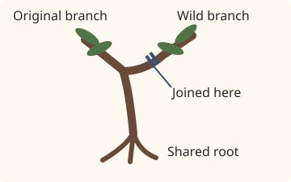

# Romans 11 — God remembers his people and shows mercy

**About this chapter**

Paul remembers Elijah, who thought he was alone in trusting God.

Then Paul uses an olive tree to warn Gentile believers against pride.

## Elijah thought he was alone

## Romans 11:1

Has God turned his people away?

Of course not!

I am an Israelite myself.

I come from Abraham’s family, from the tribe of Benjamin.

## Romans 11:2

God has kept the people he knew long ago.

Remember what the Scriptures say about Elijah.

Elijah brought this complaint about Israel to God.

## Romans 11:3

“Lord, they have killed your prophets.

They have torn down your altars.

I am the only one left.

Now they want to kill me too.”

**Help with these words**

Prophets spoke God’s messages. Altars were places where people brought gifts to worship God.

## Romans 11:4

God answered Elijah, “I have kept seven thousand men for myself.

They have never bowed down to worship Baal.”

**Help with these words**

Baal was a god some people worshipped.

## Romans 11:5

It is the same today.

Some of Israel’s people remain faithful.

God chose them in his kindness.

## Romans 11:6

That kindness is a gift.

If people earned it by what they did, it would no longer be a gift.

**Pause and answer**

What did God tell Elijah when Elijah thought he was alone?

## Some believed and others would not listen

## Romans 11:7

Israel sought to be right with God.

Israel as a whole did not receive what it sought.

Those God chose received it.

The others grew hard in their hearts.

## Romans 11:8

The Scriptures say, “God made them like people in a deep sleep.

To this day their eyes do not see and their ears do not hear.”

**Help with these words**

Paul uses seeing and hearing to describe understanding God’s message.

## Romans 11:9

David also said, “May their own table become a trap for them.

May they stumble there and receive the punishment due to them.

## Romans 11:10

May their eyes grow dark so they cannot see.

May their backs stay bent for ever.”

**Help with these words**

A table is where people expect to eat in safety. David pictures that very place becoming dangerous for them.

**Pause and answer**

What does the picture of people in a deep sleep help explain?

## Paul hopes his own people will turn to God

## Romans 11:11

Did my people stumble so badly that they can never get up?

Of course not!

Because they did wrong, salvation came to the Gentiles.

This was meant to make Israel want that gift too.

**Help with these words**

Gentiles are people who are not Jewish.

## Romans 11:12

Their wrongdoing has already brought rich blessings to the world.

Their loss has brought rich blessings to the Gentiles.

Imagine how much greater the blessing when Israel comes in fully!

## Romans 11:13

Now I am speaking to you Gentiles.

God sent me to you as an apostle.

I give this work great honour.

## Romans 11:14

I hope my own people will want what you have received.

I hope some of them will be saved.

## Romans 11:15

Their rejection meant that the world could have peace with God.

What will their acceptance mean?

It will be like life from the dead!

**Pause and answer**

What does Paul hope will happen to some of his own people?

## A branch depends on the root

## Romans 11:16

If the first piece of dough belongs to God, the whole batch is holy.

If a tree’s root is holy, its branches are holy too.

## Romans 11:17

Picture an olive tree with some branches broken off.

You Gentiles are like a branch from a wild olive tree.

God joined you to the tree among the other branches.

Now the same root feeds you all.

## Romans 11:18

So do not boast that you are better than the other branches.

Remember which part supports the other.

The root supports you.

## Romans 11:19

You may say, “God broke off branches to make room for me.”

## Romans 11:20

Yes, God broke them off because they did not trust him.

You stand because you trust him.

Take this seriously and guard against pride.

## Romans 11:21

God did not spare branches that grew on the tree.

He will not spare you either.

**Pause and answer**

What feeds both the wild branch and the other branches?

## God can join branches to the tree again

## Romans 11:22

Think about God’s kindness and how firmly he judges.

He judged those who fell.

He shows you kindness if you continue to depend on his kindness.

Otherwise he will cut you off too.

## Romans 11:23

If those people turn from unbelief, God will join them to the tree again.

He has the power to do that.

## Romans 11:24

You were like a branch cut from a wild olive tree.

God did something unusual by joining you to a tree people had planted and tended.

How much easier to join the original branches to their own tree!

**Pause and answer**

What can God do for the branches that were broken off?

## Paul speaks about mercy for Israel and the Gentiles

## Romans 11:25

Brothers and sisters, I want you to understand a mystery.

It will keep you from thinking too highly of yourselves.

Part of Israel has become unwilling to listen.

This will last until the full number of Gentiles has come in.

## Romans 11:26

In this way God will save all Israel.

The Scriptures say, “The rescuer will come from Zion.

He will turn Jacob’s people away from their ungodly ways.

## Romans 11:27

This is the agreement I make with them when I take away their sins.”

**Help with these words**

Zion is a name for Jerusalem. Jacob’s people are the people of Israel.

## Romans 11:28

As far as the good news is concerned, they are enemies for your sake.

Yet God chose their ancestors, and he loves their people.

## Romans 11:29

God does not take back his gifts.

When he calls people, he keeps his word.

## Romans 11:30

You Gentiles once disobeyed God.

Now you have received mercy because of Israel’s disobedience.

## Romans 11:31

They too have now disobeyed.

Through the mercy God showed you, they too may receive mercy.

## Romans 11:32

God has held all people under the power of their disobedience.

His purpose is to show mercy to all.

**Pause and answer**

To whom does God want to show mercy?

## Paul praises God

## Romans 11:33

How rich are God’s wisdom and knowledge!

No one can fully explain his decisions.

No one can trace all his ways.

## Romans 11:34

The Scriptures ask, “Who knows the mind of the Lord?

Who has ever given him advice?”

## Romans 11:35

“Who has given God something first so that God owes them anything?”

## Romans 11:36

Everything comes from God.

Everything exists through God and for God.

May he receive glory for ever!

Amen.

**Pause and answer**

What does Paul say comes from God?
