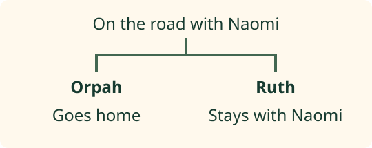

# Ruth 1 — Ruth stays with Naomi

**About this chapter**

Naomi loses her husband and sons in Moab. She sets out for her old home in Bethlehem. Ruth must decide whether to go with her.

## A family leaves Bethlehem

## Ruth 1:1

Judges were leading Israel in those days.

People had too little food to eat.

A man left Bethlehem in Judah to live in Moab.

His wife and two sons went with him.

## Ruth 1:2

The man’s name was Elimelech.

His wife’s name was Naomi.

Their sons were Mahlon and Chilion.

They belonged to the Ephrathite people of Bethlehem.

The family settled in Moab.

**Reading help**

Here judges were leaders who helped Israel in times of trouble.

## Ruth 1:3

Then Elimelech died.

Naomi still had her two sons.

## Ruth 1:4

The sons married women from Moab.

One woman was Orpah.

The other was Ruth.

The family lived in Moab about ten years.

## Ruth 1:5

Then Mahlon and Chilion died too.

Naomi had lost her husband and both sons.

**Pause and answer**

Who were the two women Naomi’s sons married?

## Naomi starts for home

## Ruth 1:6

In Moab, Naomi heard news from home.

The LORD had given his people food.

Naomi got ready to leave Moab.

Orpah and Ruth got ready too.

## Ruth 1:7

The three women left their home in Moab.

They took the road to Judah.

**Reading help**

Ruth and Orpah were Naomi’s daughters-in-law. Each had married one of her sons.

## Ruth 1:8

Naomi said, “Go back, each to your mother’s home.

You showed faithful love to your husbands before they died.

You have shown that same love to me.

May the LORD show you that love too.

## Ruth 1:9

May the LORD give each of you a husband and a peaceful home.”

Naomi kissed them.

They cried aloud.

## Ruth 1:10

Orpah and Ruth said, “We will go with you to your people.”

**Pause and answer**

Where did Naomi tell Ruth and Orpah to go?

## Naomi asks the women to go back

## Ruth 1:11

Naomi said, “Go home, my daughters.

Why come with me?

I have no more sons for you to marry.

## Ruth 1:12

Go home, my daughters.

I am too old to marry again.

Suppose I did marry tonight and later had sons.

## Ruth 1:13

Would you stay single until they grew up?

No, my daughters.

My pain is even greater than yours.

I feel the LORD has turned against me.”

## Ruth makes a promise

## Ruth 1:14

The women cried aloud again.

Orpah kissed Naomi goodbye.

But Ruth held on to Naomi.

## Ruth 1:15

Naomi said, “Orpah has gone back to her people and her gods.

Go home with her.”

## Ruth 1:16

Ruth answered, “Please stop asking me to leave you.

Where you go, I will go.

Where you live, I will live.

Your people will be my people.

Your God will be my God.

## Ruth 1:17

Where you die, I will die.

That is where people will bury me.

May the LORD punish me severely if I let anything but death part us.”

## Ruth 1:18

Naomi saw that Ruth had made up her mind.

So Naomi stopped asking Ruth to go back.

**Pause and answer**

What did Ruth promise about Naomi’s people?

## Two women arrive in Bethlehem

## Ruth 1:19

Naomi and Ruth walked on to Bethlehem.

News of their arrival stirred the whole town.

The women asked, “Can this be Naomi?”

## Ruth 1:20

Naomi answered, “Call me Mara instead of Naomi.

God Almighty has brought me great pain.

**Reading help**

Naomi means “pleasant.” Mara means “bitter.” Naomi chose the name Mara to tell people how deeply she hurt.

## Ruth 1:21

I left here full.

The LORD has brought me back empty.

Why call me Naomi?

The LORD has spoken against me.

God Almighty has brought suffering on me.”

**Reading help**

“Full” and “empty” describe Naomi’s loss. Her husband and sons left Bethlehem with her. All three died in Moab.

## Ruth 1:22

So Naomi came home from Moab.

Ruth, her son’s wife from Moab, came with her.

In Bethlehem people were starting to gather the barley crop.

**Reading help**

Barley is a grain people grow for food.

**Pause and answer**

What crop were the people gathering when Ruth arrived?
