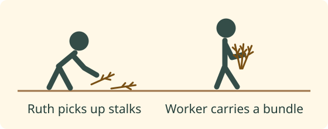

# Ruth 2 — Ruth gathers grain in Boaz’s field

**About this chapter**

Ruth goes to find food for Naomi and herself. In a barley field, she meets Boaz. He makes room for her among his workers.

## Ruth goes to gather grain

## Ruth 2:1

Naomi’s husband Elimelech had a relative named Boaz.

People respected Boaz.

He was a good man.

## Ruth 2:2

Ruth came from Moab.

She said to Naomi, “Please let me go to the fields.

Someone may let me gather the grain left behind.”

Naomi answered, “Go ahead, my daughter.”

## Ruth 2:3

Ruth went to gather grain behind the workers.

She happened to enter a field that belonged to Boaz.

Boaz belonged to Elimelech’s family.

**Reading help**

People harvested grain by cutting its stalks. Ruth walked behind them. She picked up stalks they left behind. This work is called gleaning.

## Boaz asks about Ruth

## Ruth 2:4

Just then Boaz came from Bethlehem.

He greeted the workers, “The LORD be with you.”

The workers answered, “May the LORD bless you.”

## Ruth 2:5

Boaz spoke to the man in charge of the workers.

He asked, “What family does that young woman belong to?”

## Ruth 2:6

The man answered, “She comes from Moab.

She came back with Naomi.

## Ruth 2:7

She asked to gather grain among the bundles behind the workers.

She has worked here since morning.

She rested only a short time in the shelter.”

**Pause and answer**

Who came back from Moab with Ruth?

## Boaz welcomes Ruth

## Ruth 2:8

Boaz said to Ruth, “Listen, my daughter.

Stay here to gather grain in my field.

Stay close to the women who work for me.

**Reading help**

“My daughter” is a kind way for Boaz to speak to Ruth here.

## Ruth 2:9

Watch where the workers are cutting grain.

Follow the women into that field.

I have told the young men to leave you alone.

When you are thirsty, drink from the jars.

The young men have filled them with water.”

## Ruth 2:10

Ruth bowed with her face to the ground.

She asked Boaz, “I come from another country.

Why have you noticed me and shown me such kindness?”

## Boaz tells Ruth what he has heard

## Ruth 2:11

Boaz answered, “I heard how you cared for Naomi after your husband died.

You left your parents and your own land.

You came to live among strangers.

## Ruth 2:12

May the LORD reward you richly for what you did.

You came to the LORD, the God of Israel, for shelter under his wings.”

**Reading help**

A bird shelters its young under its wings. Boaz uses that picture to say Ruth trusts God to protect her.

## Ruth 2:13

Ruth said, “Sir, please keep showing me kindness.

Your kind words have comforted me.

I do not even have the standing of one of your servants.”

**Pause and answer**

Who did Ruth care for after her husband died?

## Ruth eats with the workers

## Ruth 2:14

At mealtime Boaz called Ruth over.

He said, “Take some bread.

Dip it in the vinegar sauce.”

Ruth sat beside the workers.

Boaz gave her roasted grain.

Ruth ate until she was full.

She still had food left.

## Ruth 2:15

When Ruth went back to gather grain, Boaz spoke to his young men.

“Let her gather even among the bundles.

Do not insult her.

## Ruth 2:16

Pull some stalks out of the bundles for her.

Leave them for Ruth to pick up.

Do not scold her.”

## Ruth brings food home

## Ruth 2:17

Ruth gathered grain until evening.

Then she beat the stalks to free the grains.

She had about an ephah of barley.

**Reading help**

An ephah was a measure people used for grain. One ephah held about 22 liters.

## Ruth 2:18

Ruth carried the barley into town.

Naomi saw how much Ruth had gathered.

Ruth also gave Naomi the food left from her meal.

**Pause and answer**

What did Ruth give Naomi besides the barley?

## Ruth 2:19

Naomi asked, “Where did you gather grain today?

May God bless the man who noticed you.”

Ruth told Naomi about the field.

She said, “The man I worked with today is Boaz.”

## Naomi explains who Boaz is

## Ruth 2:20

Naomi said, “May the LORD bless Boaz.

The LORD still shows kindness to the living and the dead.”

Then Naomi explained, “Boaz is a close relative.

He is one of our family’s redeemers.”

**Reading help**

A family redeemer was a relative who could help a family in trouble. For example, he could buy back family land.

## Ruth 2:21

Ruth said, “Boaz told me to stay with his young men until they finish gathering all his grain.”

## Ruth 2:22

Naomi said, “My daughter, stay with the women who work for him.

Someone might harm you in another field.”

## Ruth 2:23

So Ruth gathered grain close to Boaz’s women workers.

She stayed through the barley harvest and the wheat harvest.

Ruth kept living with Naomi.

**Pause and answer**

Whose field did Ruth keep working in?
