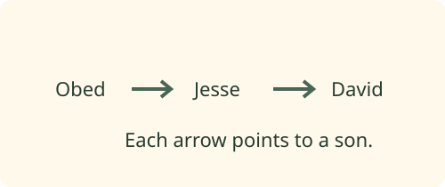

# Ruth 4 — Ruth and Boaz have a son

**About this chapter**

At the town gate, Boaz speaks up for Naomi’s family. The people of Bethlehem witness his promise and later welcome Ruth’s son.

## Boaz meets the closer relative

## Ruth 4:1

Boaz went to the town gate and sat down.

Soon the closer family redeemer came by.

Boaz said, “Come sit here, my friend.”

The man sat beside him.

## Ruth 4:2

Boaz asked ten elders of the town to sit there too.

The elders sat down.

**Reading help**

The elders were leaders of the town. People met at the town gate to settle important matters.

## Ruth 4:3

Boaz told his relative, “Naomi has come back from Moab.

She is selling land that belonged to our relative Elimelech.

## Ruth 4:4

You have the first right to buy it back.

You can buy it here before these people and the elders.

If you decide against it, please tell me.

I have the next right after you.”

The relative answered, “I will buy it back.”

**Reading help**

To redeem the land means to buy it back for the family.

## The relative gives Boaz his right

## Ruth 4:5

Boaz said, “When you buy the land from Naomi and Ruth, you must also marry Ruth.

Ruth comes from Moab and her husband died.

His family name must continue on his land.”

## Ruth 4:6

The relative said, “Then I cannot buy it back.

I might lose what my own family would inherit.

I give you my right to buy it.”

**Pause and answer**

Why did the closer relative give up his right?

## Ruth 4:7

Long ago in Israel, people had a custom for buying back or exchanging property.

One man took off his sandal.

He handed it to the other man.

This showed that their agreement would stand.

## Ruth 4:8

So the relative took off his sandal.

He told Boaz, “Buy the land yourself.”

## The people hear Boaz’s promise

## Ruth 4:9

Boaz spoke to the elders and all the people.

“Today you are witnesses.

I am buying from Naomi everything that belonged to Elimelech and his sons, Chilion and Mahlon.

**Reading help**

Witnesses are people who can tell others what they saw or heard.

## Ruth 4:10

I am also taking Ruth from Moab as my wife.

She was Mahlon’s wife before he died.

His name will continue on his family land.

His relatives and his hometown will remember his name.

You are witnesses today.”

## Ruth 4:11

The elders and the people at the gate answered, “We are witnesses.

May the LORD make Ruth like Rachel and Leah.

Their families grew to become the people of Israel.

May you do well in Ephrathah.

May people throughout Bethlehem know your name.

**Reading help**

Rachel and Leah were mothers long ago. Many people in Israel came from their family.

## Ruth 4:12

Long ago Tamar and Judah had a son named Perez.

May the LORD give you children through Ruth.

May your family grow like the family of Perez.”

**Pause and answer**

Who heard Boaz make his promise?

## Ruth gives birth to Obed

## Ruth 4:13

Boaz married Ruth.

They slept together as husband and wife.

The LORD helped Ruth become pregnant.

Ruth gave birth to a son.

## Ruth 4:14

The women said to Naomi, “Praise the LORD!

Today he has given you a family redeemer.

May people throughout Israel know this child’s name.

## Ruth 4:15

He will give you new strength.

He will care for you in your old age.

Ruth loves you.

She is worth more to you than seven sons.

She has given birth to this child.”

## Ruth 4:16

Naomi took the baby onto her lap.

She helped care for him.

## Ruth 4:17

The women who lived nearby said, “Naomi has a son!”

They named the child Obed.

Obed became Jesse’s father.

Jesse became David’s father.

**Reading help**

Ruth gave birth to Obed. The neighbors’ words show what his birth meant to Naomi and her family.

**Pause and answer**

Who helped Ruth care for Obed?

## The family from Perez to David

## Ruth 4:18

Here is the family line that began with Perez.

Perez was Hezron’s father.

## Ruth 4:19

Hezron was Ram’s father.

Ram was Amminadab’s father.

## Ruth 4:20

Amminadab was Nahshon’s father.

Nahshon was Salmon’s father.

## Ruth 4:21

Salmon was Boaz’s father.

Boaz was Obed’s father.

## Ruth 4:22

Obed was Jesse’s father.

Jesse was David’s father.

**Pause and answer**

How was Obed related to David?
