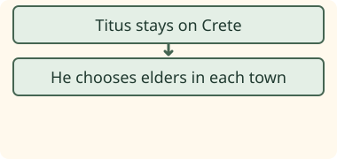

# Titus 1 — Choose leaders who hold to the truth

**About this chapter**

Paul writes to Titus on the island of Crete.

He explains how Titus can recognize a trustworthy church leader.

## Paul greets Titus

## Titus 1:1

I am Paul, a servant of God.

Jesus Christ sent me as an apostle to help God’s chosen people trust him.

I help them learn the truth that shows them how to live for God.

**Help with these words**

An apostle is someone Jesus sends to speak for him.

## Titus 1:2

We hope for life that lasts forever.

God promised this life before time began.

God cannot lie.

## Titus 1:3

When the time was right, God made his message known.

God our Savior trusted me with it and commanded me to announce it.

## Titus 1:4

Titus, you are like my own child.

We share the same faith.

May God the Father and Christ Jesus our Savior give you grace and peace.

**Pause and answer**

What did God promise before time began?

## Choose leaders in each town

## Titus 1:5

I left you on Crete to finish work we had begun.

Remember my instructions to choose elders in every town.

| Place | Work for Titus |
| --- | --- |
| Each town on Crete | Choose elders to care for the church. |

The task on the island was to appoint local leaders.

**Help with these words**

Elders lead and care for the church.

Paul also calls a leader who does this an overseer.

## Titus 1:6

Choose a man whose life is free from blame.

He must be the husband of just one wife.

His children must be believers.

Their conduct must give no grounds for charges of wild living or rebellion.

## Titus 1:7

God trusts an overseer to care for his household.

So his life must be free from blame.

He must avoid insisting on his own way or losing his temper quickly.

He must avoid drunkenness, violence, and greed.

## Titus 1:8

He must welcome guests and love what is good.

He must be fair, holy, and able to control himself.

## Titus 1:9

He must hold firmly to the trustworthy message he learned.

Then he can encourage others with sound teaching.

He can also show where those who oppose it are wrong.

**Pause and answer**

How should an overseer treat guests?

## Stop teaching that harms families

## Titus 1:10

Many people resist instruction.

They deceive others with empty talk.

This is especially true of those who insist on circumcision.

**Help with these words**

Circumcision is a mark made by removing the foreskin of the penis.

These teachers wanted other believers to receive that mark.

## Titus 1:11

You must stop them from teaching such things.

They upset whole families to get money dishonestly.

## Titus 1:12

One of Crete’s own prophets described his people this way.

“Cretans always lie.

They act like vicious animals and lazily eat their fill.”

## Titus 1:13

What he said is true.

So correct these people firmly to help them grow healthy in their faith.

## Titus 1:14

Then they will stop listening to made-up Jewish stories and to rules from people who turn away from the truth.

**Pause and answer**

Why does Paul tell Titus to correct these people?

## What people do shows what they believe

## Titus 1:15

To people who are pure, everything is pure.

To people corrupted by wrong who refuse to believe, nothing is pure.

Wrong has affected both their thoughts and their sense of right and wrong.

## Titus 1:16

They say they know God.

Yet the way they live denies him.

They do hateful things and disobey God.

They are unfit to do any good work.

**Pause and answer**

What shows whether these people mean what they say?
