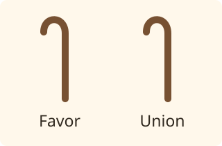

# Zechariah 11 — A shepherd with two staffs

**About this chapter**

The LORD tells Zechariah to care for a flock.

Zechariah acts out a message about what will happen to the people.

He uses two shepherd’s staffs to show what the message means.

## Grief over the ruined land

## Zechariah 11:1

Lebanon, open your doors!

Let the fire burn your cedar trees!

Zechariah speaks to the land as if it were a house.

## Zechariah 11:2

Cry out, cypress trees!

The cedars have fallen.

The great trees lie in ruins.

Cry out, oak trees of Bashan!

People have cut down the thick forest.

## Zechariah 11:3

Listen to the shepherds weeping.

Everything they took pride in lies in ruins.

Listen to the young lions roaring.

They have lost the thick bushes along the Jordan River.

## The LORD gives Zechariah a flock

## Zechariah 11:4

The LORD my God said to me, “Care for these sheep.

People plan to kill them.

## Zechariah 11:5

“The buyers kill the sheep and feel no guilt.

The sellers say, ‘Praise the LORD! I am rich!’

Even their own shepherds show the sheep no pity.

## Zechariah 11:6

“I too will stop showing pity to the people of this land.

I will put each person under the power of a neighbor and a king.

They will wreck the land.

I will not rescue it from them.”

## Zechariah 11:7

So I cared for the sheep that people planned to kill.

I especially cared for the sheep that were suffering.

I took two staffs, the long sticks a shepherd carries.

I named one Favor and the other Union.

I used them as I tended the flock.

## Zechariah 11:8

In one month I sent away three shepherds.

I lost patience with the flock.

They hated me too.

## Zechariah 11:9

I told the flock, “I will no longer care for you.

Let the dying die.

Let those facing destruction perish.

Let those who survive eat each other’s flesh.”

## Zechariah breaks the two staffs

## Zechariah 11:10

I took the staff called Favor and cut it in two.

This ended the covenant I had made with all the nations.

A covenant is a solemn agreement.

## Zechariah 11:11

That day the agreement ended.

The suffering ones in the flock were watching me.

They knew the message came from the LORD.

## Zechariah 11:12

I said, “If you think it right, pay me for my work.

Otherwise, keep the money.”

They weighed out thirty pieces of silver as my pay.

## Zechariah 11:13

The LORD said to me, “Throw it to the potter!”

A potter makes things from clay.

What a splendid price they thought I was worth!

Those words show how little they valued me.

I took the thirty pieces of silver into the LORD’s house.

There I threw them to the potter.

## Zechariah 11:14

Then I cut my second staff in two.

Its name was Union, which means being joined together.

Breaking it showed that Judah and Israel would no longer live as brothers.

## A shepherd who abandons the sheep

## Zechariah 11:15

Then the LORD said to me, “Take up shepherd’s tools again.

This time act as a foolish shepherd.

## Zechariah 11:16

“I will put a shepherd over this land.

He will leave the lost sheep without help.

He will not look for the young ones.

He will leave the injured sheep without care.

He will not feed the healthy ones.

Instead he will eat the meat of the best sheep.

He will even tear off their hooves.

## Zechariah 11:17

“How terrible for the worthless shepherd who leaves his flock!

May a sword strike his arm and his right eye.

May his arm waste away completely.

May his right eye lose all sight.”

**Pause and answer**

What did Zechariah call the staff that stood for Judah and Israel being joined together?
