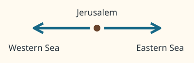

# Zechariah 14 — The LORD will be King over all the earth

**About this chapter**

Zechariah describes a day when enemies will take Jerusalem. The LORD will fight for the city. Later, people from the nations that attacked it will come there to worship.

## A way out of Jerusalem

## Zechariah 14:1

People of Jerusalem, the day of the LORD is coming.

Enemies will divide up your belongings while you watch.

## Zechariah 14:2

The LORD says, “I will gather the nations to fight Jerusalem.”

The attackers will take the city and rob the homes.

They will rape women there.

They will force half the people to leave their homeland.

The rest will stay in Jerusalem.

## Zechariah 14:3

Then the LORD will go out against those nations.

He will fight as he does on a day of battle.

## Zechariah 14:4

His feet will stand on the Mount of Olives, east of Jerusalem.

The mountain will split. Half will move north and half south.

A wide valley will open, running east to west.

## Zechariah 14:5

You will escape through that valley. It will reach Azal.

You will run as people ran from the earthquake when Uzziah ruled Judah.

Then the LORD my God will come.

All his holy ones will come with him.

## Water will flow from Jerusalem

## Zechariah 14:6

On that day there will be no light.

There will be no cold or frost.

## Zechariah 14:7

Only the LORD knows that day. No other day is like it.

There will be neither day nor night as we know them.

Yet when evening comes, there will be light.

## Zechariah 14:8

Fresh water will flow out of Jerusalem.

Half will flow toward the Eastern Sea and half toward the Western Sea.

The water will flow in both summer and winter.

## Zechariah 14:9

The LORD will be King over the whole earth.

He alone will be LORD. People will honor his name alone.

## Zechariah 14:10

The land from Geba to Rimmon, south of Jerusalem, will become flat.

Jerusalem will stand high in its own place.

The city will stretch from the Benjamin Gate past the old First Gate to the Corner Gate.

It will reach from Hananel's Tower to the king's winepresses.

People pressed grapes there to make wine.

## Zechariah 14:11

People will live safely in Jerusalem.

Never again will anyone destroy the whole city.

## The armies that attacked the city

## Zechariah 14:12

The LORD will send a terrible sickness on the armies that fought Jerusalem.

Their flesh will rot while they are still standing.

The sickness will destroy their eyes and tongues.

## Zechariah 14:13

The LORD will make those soldiers panic.

They will grab one another and fight each other.

## Zechariah 14:14

People from Judah will fight at Jerusalem too.

They will gather the wealth of the surrounding nations.

There will be piles of gold, silver, and clothing.

## Zechariah 14:15

The sickness will also strike the animals in the enemy camps.

It will strike horses, mules, camels, donkeys, and all the other animals.

## The nations come to worship the King

## Zechariah 14:16

Some people from the attacking nations will survive.

Each year they will come to Jerusalem to worship the King, the LORD who commands heaven's armies.

They will celebrate the Feast of Tabernacles.

At this feast people stay in temporary shelters.

## Zechariah 14:17

If a family on earth refuses to come and worship the King, no rain will fall on its land.

## Zechariah 14:18

This warning includes Egypt. If its people refuse to come, they too will have no rain.

The LORD will bring this trouble on nations that refuse to celebrate the feast.

## Zechariah 14:19

Egypt and every other nation will face the same punishment if they stay away.

## Even the cooking pots will be holy

## Zechariah 14:20

Words on the horses' bells will say, “Holy to the LORD.”

Holy means set apart for God.

The cooking pots in the temple will be as holy as the bowls used at the altar.

## Zechariah 14:21

Every pot in Jerusalem and Judah will be holy to the LORD who commands heaven's armies.

People bringing sacrifices will take these pots and cook in them.

On that day no Canaanite will remain in the LORD's temple.

**Think about it**

**Why will people from other nations come to Jerusalem each year?**
