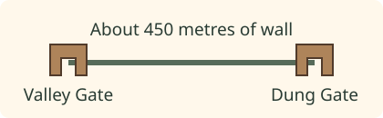

# Zechariah 2 — The LORD promises to live in Jerusalem

**About this chapter**

In a vision, Zechariah sees a man going to measure Jerusalem. The LORD promises to protect the people and live among them.

## A man measures the city

## Zechariah 2:1

I looked up and saw a man.

He held a measuring line in his hand.

A measuring line is a cord for measuring a distance.

## Zechariah 2:2

I asked, “Where are you going?”

“To measure Jerusalem,” the man answered.

“I want to know how wide and how long it is.”

## Zechariah 2:3

The angel who had been talking with me went out.

Another angel came to meet him.

## Zechariah 2:4

The second angel said, “Run! Tell that young man this news.

Jerusalem will have so many people and farm animals that they will live beyond any city walls.”

## Zechariah 2:5

The LORD says, “I will be like a wall of fire around Jerusalem.

I will be the glory inside the city.”

The LORD Himself will protect the city and be there with His people.

## A call to leave Babylon

## Zechariah 2:6

The LORD says, “Get up! Hurry!

Leave the land in the north.

I scattered you in every direction, like the four winds.

## Zechariah 2:7

“People of Zion, get up!

You who live in Babylon, escape!”

Zion is another name for Jerusalem.

## Zechariah 2:8

The LORD leads the armies of heaven.

This is His message.

“The glorious LORD sent Me against the nations that robbed you.

Anyone who hurts you touches the most tender part of His eye.”

This shows how precious His people are to Him.

## Zechariah 2:9

“I will raise My hand against those nations.

Their own servants will take their goods.

Then you will know who sent Me.

It was the LORD who leads heaven’s armies.”

## Many nations will belong to the LORD

## Zechariah 2:10

The LORD says, “People of Zion, sing and shout for joy!

I am coming to live among you.

## Zechariah 2:11

“On that day many nations will join the LORD.

They will be My people.

I will live among you.

Then you will know the LORD of heaven’s armies sent Me to you.”

## Zechariah 2:12

The LORD will take Judah as His own part of the holy land.

He will choose Jerusalem again.

## Zechariah 2:13

Everyone, be silent before the LORD.

He has risen to act from His holy home.

**Pause and answer**

Who promises to protect Jerusalem like a wall of fire?
