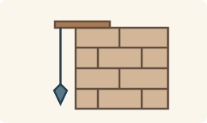

# Zechariah 4 — Zerubbabel will finish the temple

**About this chapter**

Zechariah sees a gold lampstand and two olive trees in a vision. The LORD has a message for Zerubbabel, the man rebuilding the temple.

## Seven lamps and two trees

## Zechariah 4:1

The angel who had spoken with me came back.

He woke me as if I had been asleep.

## Zechariah 4:2

The angel asked, “What do you see?”

I said, “I see a stand made of solid gold.

It has a bowl on top and seven lamps.

Seven spouts lead to the lamps.

## Zechariah 4:3

“Two olive trees grow beside the stand.

One is on the right of the bowl.

The other is on the left.”

## Zechariah 4:4

I asked the angel, “Sir, what do these things mean?”

## Zechariah 4:5

“Do you know what they are?” he asked.

“No, sir,” I answered.

## A message for the man building the temple

## Zechariah 4:6

The angel gave me the LORD’s message for Zerubbabel.

“Human strength and power cannot do this work.

My Spirit will make it happen.”

The LORD who leads heaven’s armies said this.

## Zechariah 4:7

“Even a great mountain will become flat ground before Zerubbabel.”

This means that even a great obstacle will give way.

“Zerubbabel will bring out the stone that finishes the temple.

People will shout, ‘God bless it! God bless it!’”

## Zechariah 4:8

Then the LORD gave me another message.

## Zechariah 4:9

“Zerubbabel laid the first stones of this temple himself.

His own hands will finish it.”

Then you will know who sent me to you.

It was the LORD who leads heaven’s armies.

## Zechariah 4:10

Who looked down on the work when it began so small?

The seven eyes of the LORD look across the whole earth.

They will see Zerubbabel holding a plumb line and rejoice.

A plumb line is a cord with a weight on it.

It helps a builder check that a wall stands straight.

## What the olive trees mean

## Zechariah 4:11

I asked the angel about the two olive trees.

“What do the trees on either side of the lampstand mean?”

## Zechariah 4:12

Then I asked, “What do the two olive branches mean?

They are beside two gold pipes.

Golden oil pours from the pipes.”

## Zechariah 4:13

“Do you know what they mean?” the angel asked.

“No, sir,” I answered.

## Zechariah 4:14

The angel said, “They stand for the two anointed ones.

These two stand beside the Lord of all the earth.”

Anointing someone with oil showed that God had chosen that person to serve.

**Pause and answer**

Who laid the first stones and will finish the temple?
