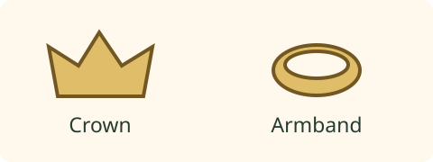

# Zechariah 6 — Four chariots and a crown

**About this chapter**

Zechariah sees four chariots in a vision. Later, the LORD tells him to make a crown and gives him a message for Joshua the high priest.

## Four teams of horses

## Zechariah 6:1

I looked up again.

Four chariots came out between two mountains made of bronze.

A chariot is a cart pulled by horses.

## Zechariah 6:2

Red horses pulled the first chariot.

Black horses pulled the second.

## Zechariah 6:3

White horses pulled the third chariot.

Horses with patches of color pulled the fourth.

All the horses were strong.

## The horses go out across the earth

## Zechariah 6:4

I asked the angel who was speaking with me, “Sir, what do these mean?”

## Zechariah 6:5

The angel said, “These are the four spirits of heaven.

They stood before the Lord of all the earth.

Now they are going out.

## Zechariah 6:6

“The black horses are going north.

The white horses are going west.

The horses with patches of color are going south.”

## Zechariah 6:7

The strong horses were eager to go and watch over the earth.

The LORD said, “Go and travel through the earth.”

So they went.

## Zechariah 6:8

Then the LORD called me over.

He said, “Look at the ones going north.

They have brought rest to My Spirit in the land of the north.”

## A crown for Joshua

## Zechariah 6:9

Then the LORD gave me another message.

## Zechariah 6:10

“Three men have come from Babylon, where the people of Judah had been forced to live.”

Their names were Heldai, Tobijah, and Jedaiah.

“Take the gift they bring.

That same day, go to the house of Josiah, the son of Zephaniah.

## Zechariah 6:11

“Use the silver and gold to make a decorated crown.

Put it on the head of Joshua, the son of Jehozadak.

Joshua is the high priest.”

## The man called the Branch

## Zechariah 6:12

The LORD who leads heaven’s armies told me what to say to Joshua.

“Here is the man called the Branch.

Like a branch growing from a tree, He will grow from His place.

He will build the LORD’s temple.

## Zechariah 6:13

“Yes, He will build the LORD’s temple.

He will have great honor and rule from His throne.

He will also serve as a priest on His throne.

The work of king and priest will fit together in peace.

## Zechariah 6:14

“Keep the crown in the LORD’s temple.

It will remind people of Helem, Tobijah, and Jedaiah.

It will also remind them of Zephaniah’s kind son.

## Zechariah 6:15

“People from far away will come and help build the LORD’s temple.

Then you will know the LORD who leads heaven’s armies sent Me to you.

This will happen if you listen carefully and obey the LORD your God.”

**Pause and answer**

What did the LORD tell Zechariah to put on Joshua’s head?
